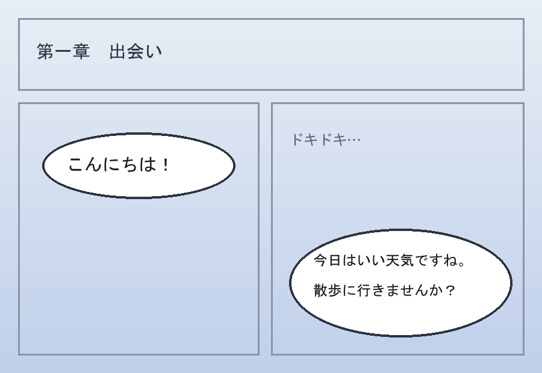
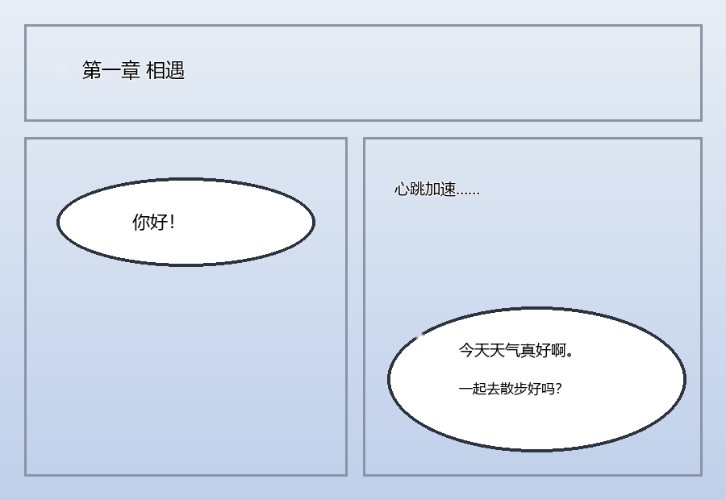
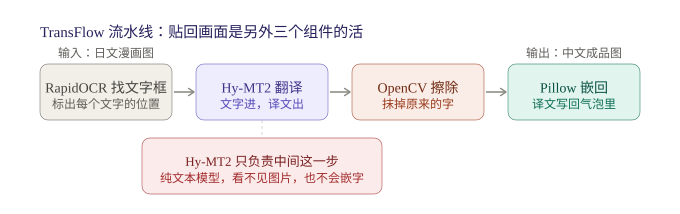

# TransFlow


**本地图片翻译 + 自动嵌字流水线（全离线）**：把一文件夹日文/英文漫画拖到 bat 上，还你一整套嵌好中文译文的成品图。OCR、翻译、擦字、嵌字全部在本机完成，图片不出门。

> **English**: TransFlow is a fully offline image/manga translation pipeline. RapidOCR finds the text bubbles, a local LLM (via Ollama) translates them, OpenCV inpaints the original text away, and Pillow renders the translation back into place — complete with automatic font sizing, line wrapping, centering and stroke. Windows-first with drag-and-drop `.bat` entry points; everything is also scriptable from the command line.

## 效果

| | |
|---|---|
| 输入 | 日文/英文漫画页（jpg / png / webp / bmp），可含子目录 |
| 输出 | `translated\` 里的汉化成品图 + 双语对照图 + json 复查文件 |
| 速度 | 混元 Hy-MT2-1.8B 约 4 秒/张（44 页约 3 分钟）；Qwen3-8B 约 25-30 秒/张 |

实跑演示（合成测试图，非真实漫画）：

| 原图（日文） | 成品（中文嵌回） |
|:---:|:---:|
|  |  |

## 流水线



| 步骤 | 组件 | 职责 |
|---|---|---|
| ① | RapidOCR（PP-OCRv6） | 检测并识别每个文字气泡，给出坐标 |
| ② | Ollama + 本地 LLM | 纯文本翻译：文字进，译文出 |
| ③ | OpenCV inpaint | 按坐标擦掉原文，用周围画面补全 |
| ④ | Pillow | 把译文写回气泡：自动字号 / 换行 / 居中 / 描边，支持竖排 |

注意：翻译模型只负责第 ② 步——它是纯文本模型，看不到图片，也不会嵌字。

## 安装（Windows）

1. **Python 3.10+**：<https://www.python.org>（安装时勾选 *Add Python to PATH*）
2. **双击 `install.bat`**：自动创建虚拟环境并安装全部依赖
   - 国内安装失败？用阿里云源：
     `.venv\Scripts\python.exe -m pip install -r requirements.txt -i https://mirrors.aliyun.com/pypi/simple/`
3. **Ollama**：<https://ollama.com/download>，然后拉模型：
   ```bash
   ollama pull maternion/hy-mt2:1.8b
   ```
4. 把任意图片文件夹拖到 `TransFlow-HyMT2.bat` 上，开翻。

> 想换模型？Ollama 里任何模型都行，改 bat 里的 `--model` 参数即可（见下方参数表）。

## 使用

### 拖拽党（推荐）

| bat | 模型 | 成品输出到 |
|---|---|---|
| `TransFlow-HyMT2.bat` | 混元 Hy-MT2-1.8B（快） | 源文件夹旁 `translated\` |
| `TransFlow-Qwen.bat` | Qwen3-8B 破限版（慢） | 源文件夹旁 `translated_qwen\` |
| `TransFlow-HyMT2-toFolder.bat` | 混元（快） | `transflow\output\<文件夹名>\` |
| `TransFlow-Qwen-toFolder.bat` | Qwen 破限版（慢） | `transflow\output_qwen\<文件夹名>\` |
| `TransFlow-EXPORT.bat` | 不翻译 | 把 json 里的原文/译文导出成 txt/csv 对照表 |

用法：**按住文件夹 → 拖到 bat 图标上 → 松手**。支持拖整个文件夹（自动递归子目录）或多张图片。跑完窗口会停住等你按键，日志同时写入 `logs\run.log`。

### 命令行党

```bash
# 翻一个文件夹
python translate.py "D:\漫画\第01话" --model maternion/hy-mt2:1.8b --outname translated --save-json

# 翻指定的几张图
python translate.py a.png b.jpg --src ja --tgt zh

# 竖排嵌字（日漫）
python translate.py "D:\漫画\第01话" --vertical
```

| 参数 | 作用 | 默认 |
|---|---|---|
| `--src ja --tgt zh` | 源语言 → 目标语言 | 日 → 中 |
| `--model 名字` | Ollama 模型名 | `maternity/hy-mt2:1.8b` |
| `--outname translated` | 输出子目录名（与源同级时） | `translated` |
| `--outroot 目录` | 成品统一放到别处，与源文件分离 | 无 |
| `--vertical` | 竖排嵌字 | 横排 |
| `--bilingual` | 额外输出双语对照图 | 关 |
| `--save-json` | 输出 json 复查文件 | 关 |
| `--max-side 1600` | 长边超限先缩放（0=不缩） | 1600 |
| `--font 路径` / `--font-color R,G,B` | 自定义字体 / 译文颜色 | 微软雅黑 / 黑字白描边 |

语言代码：`zh` 中文 `en` 英语 `ja` 日语 `ko` 韩语 `fr` 法语 `ru` 俄语 `th` 泰语等。

### 批量翻整个漫画库（断点续传）

```bash
python _batch_files.py "D:\漫画\库A" "D:\漫画\库B"
```

逐张翻译，每张记日志 + ETA；**输出已存在就跳过**——中断后重跑自动继续；每张图前检查模型是否在线（防止模型挂了还傻傻产出未翻译图）。

### 清理 json

```bash
python _recycle_json.py "D:\漫画\第01话\translated"
```

把指定目录下所有 json 送入**回收站**（可恢复，不是永久删除），每批 10 个、批后验证。

## 输出说明

输出目录里每张图对应：

| 文件 | 是什么 |
|---|---|
| `xxx.jpg / .png / .webp` | 嵌好译文的成品图 |
| `xxx.bilingual.*` | 双语对照图（原文位置压着译文，方便校对；`--bilingual` 时） |
| `xxx.json` | 每个文字块的坐标 + 原文 + 译文（`--save-json` 时） |

> 没有检出任何文字的页面（纯画面页）会直接复制原图当成品，不产生 json——这是正常现象，不是漏翻。

## 攻略与排障

- 中文攻略：[docs/使用攻略.md](docs/使用攻略.md) —— 场景化教程 + 模型选择 + 排障手册 + 高手向
- English playbook: [docs/PLAYBOOK.md](docs/PLAYBOOK.md)

踩坑速查：

- **bat 文件名和内容必须纯 ASCII**：中文文件名/内容在非中文代码页的 Windows 上会被 cmd 解析成乱码，导致拖拽闪退。这是本项目用血泪换来的规矩，别改回去。
- **路径里带 `[ ] ( )` 的文件夹**（如 `xxx-[BNO (...)] xxx`）：`glob` 会把方括号当通配符，导致一个文件都匹配不到。已在代码里用 `glob.escape` 修复；如果你自己写脚本处理路径，记得同样处理。
- **超长路径（>260 字符）**：Python 侧无感；PowerShell/.NET 工具会报 `PathTooLongException`。
- **窗口闪退**：看 `logs\bat_trace.log`（bat 是否被执行）和 `logs\run.log`（python 内部详情）。

## 已知限制

- **Windows 优先**：字体候选列表是 Windows 字体路径；其他系统需自备字体并用 `--font` 指定。
- **复杂背景擦字一般**：inpaint 对纯色/渐变气泡效果好，人物脸上叠字会留痕迹。
- **竖排密集小字**：气泡合并按横排逻辑设计，极端场景建议手动分块。
- **OCR 错则翻译错**：艺术字/手写体识别率下降。

## 致谢

- [RapidOCR](https://github.com/RapidAI/RapidOCR) — PP-OCRv6 文字识别（Apache-2.0）
- [Ollama](https://ollama.com) — 本地模型运行时
- 腾讯混元 Hy-MT2 / Qwen3 — 翻译模型（使用请遵守各自模型许可）
- OpenCV / Pillow / NumPy

## 许可

代码本体：[MIT](LICENSE)。第三方组件与模型遵循其各自许可。
